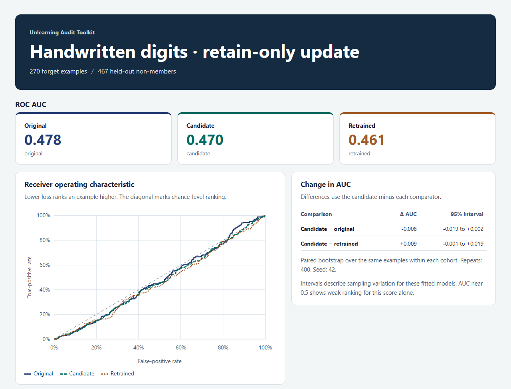

# Unlearning Audit Toolkit

[](https://github.com/keynepekar/unlearning-audit-toolkit/actions/workflows/tests.yml)
[](LICENSE)

Compare per-example losses from a machine unlearning experiment against the original model and a model retrained without the forget set. The toolkit checks that the examples line up, calculates aggregate audit statistics, and writes a standalone HTML report.



## Quick start

Use Python 3.12 or later. From a clone of the repository, install the toolkit and run the small example. The core package has no third-party runtime dependencies.

```sh
python -m pip install .
unlearning-audit validate examples/comparison.csv --manifest examples/manifest.json
unlearning-audit compare examples/comparison.csv --manifest examples/manifest.json --output metrics.json
unlearning-audit report metrics.json --output report.html
```

Open `report.html` in a browser. For downstream analysis, run `unlearning-audit report metrics.json --format csv --output summary.csv`. The example uses hand-written losses so the expected AUCs can be checked by inspection.

| Command | Input | Result |
| --- | --- | --- |
| `validate` | CSV and optional manifest | Cohort counts or a validation error |
| `compare` | CSV and manifest | JSON with ROC curves, operating points, paired AUC differences and optional utility loss |
| `report` | Saved metrics JSON | Offline HTML, an operating-point summary, or the full ROC data as CSV |
| `verify` | Fingerprinted metrics, CSV and manifest | Check that the inputs and replayed metrics match |
| `study` | Fingerprinted metrics from repeated training runs | Compare AUC differences across seeds on one fixed split |

## Reproduce the screenshot

The demo trains three small classifiers on CPU and calls the toolkit's Python API. It uses the UCI Optical Recognition of Handwritten Digits dataset distributed with scikit-learn. Use a new output directory for each run.

```sh
python -m pip install -r examples/requirements-demo.txt
python examples/digits_demo.py audit-demo
unlearning-audit report audit-demo/metrics.json --output audit-demo/report.html
```

In the captured run, the original, candidate and retrained models had AUCs of 0.478, 0.470 and 0.461. Both paired intervals included zero. The original model already showed little separation by this score, which limits what the audit can establish about the candidate. Run the script with a second output directory and `--unchanged` to check the unchanged control.

To repeat training on the same split with a different seed:

```sh
python examples/digits_demo.py audit-demo-43 --training-seed 43
unlearning-audit study audit-demo/metrics.json audit-demo-43/metrics.json --format html --output study.html
```

The [six-run example](docs/digits-study.png) shows the range and mean of each paired AUC difference, with a table of per-seed values.

## When ROC AUC misses a change

The [ridge control experiment](docs/ridge-controls.md) compares an exact update with an unchanged model. Both have the same ROC AUC on the synthetic benchmark. The paired loss gaps and the independently retrained model reveal the difference.

See the [input contract and methodology](docs/methodology.md) for cohort definitions, metric interpretation, limitations and data attribution. Report files contain aggregate statistics. Keep per-example inputs in the audit environment.

## Development

```sh
python -m unittest discover -s tests -v
```

The source code is available under the [MIT License](LICENSE).
