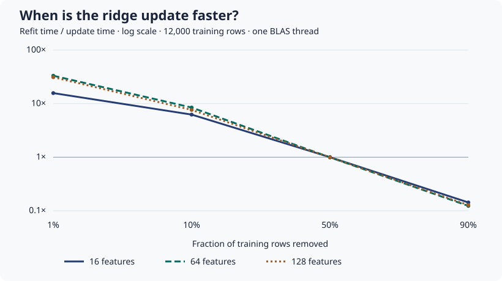

# Numerical benchmark for ridge deletion

This benchmark compares three ways to solve the same ridge objective with fixed features and no intercept: subtracting the deleted rows' sufficient statistics, forming fresh normal equations from retained rows, and fitting the retained data with scikit-learn's SVD solver. SVD serves as the independent numerical reference. Normal equations can amplify conditioning problems, and subtracting aggregates can lose additional precision when the deleted block dominates them. [Numerical Methods for Least Squares Problems](https://epubs.siam.org/doi/abs/10.1137/1.9781611977950.ch2) · [Ridge objective and solvers](https://scikit-learn.org/stable/modules/linear_model.html#ridge-regression-and-classification)

## Reproduce

Install the toolkit and the pinned demo dependencies, then run from the repository root. Choose a new output directory.

```sh
python -m pip install . -r examples/requirements-demo.txt
python examples/ridge_benchmark.py ridge-results
python examples/plot_ridge_benchmark.py ridge-results/benchmark.json ridge-results/timing.svg
```

The command writes `stress.csv`, `digits.csv`, `timing.csv` and a JSON document with the environment, tolerance and all case results. It compares coefficients and holdout predictions by relative L2 error, using absolute L2 error when the reference norm is zero. A case is outside tolerance if either error exceeds 10⁻⁶. The toolkit also reports ROC AUC and the mean absolute gap between the candidate and reference losses on paired holdout rows.

## 1. Synthetic stress matrix

The 108 cases cross three seeds, two feature counts (8, 32), three generating spectrum ratios (1, 10⁴, 10⁸), two leverage settings, and three deletion fractions (1%, 15%, 50%). A random orthogonal rotation mixes the feature directions. In the high-leverage setting, one direction is multiplied by 10⁶ for the first 15% of training rows. The removed rows are a prefix, so the smallest deletion leaves some high-leverage rows behind. The spectrum ratio is a generation setting. The CSV separately reports the condition number of the regularized matrix actually solved. The stress penalty of 10⁻¹² deliberately offers little protection from ill-conditioning.

On the recorded run, **72 of 108** updates exceeded the error tolerance. In **24** of those cases, the direct normal-equation refit agreed with SVD on coefficients within tolerance, while the downdate failed the benchmark criterion. In **29** failing cases, the candidate and SVD reference had identical ROC AUC. One such case had a **5.69%** relative prediction error on holdout. The paired loss gap in that case was **0.00334** in squared-loss units.

## 2. Public features and a derived target

The UCI handwritten digit images bundled with scikit-learn provide 64 pixel features. The target is digit parity, encoded as 0 or 1, and the objective is regularized least squares with penalty 4. The script removes exact duplicate feature rows and crosses four independently generated stratified train/holdout splits, three deletion draws per split and two deletion fractions (10%, 50%). Splits may share examples across runs, so the 24 results are descriptive rather than independent observations for inference.

All **24 runs** stayed within tolerance. The maximum relative L2 error was **8.04 × 10⁻¹⁴** for coefficients and **1.34 × 10⁻¹⁴** for holdout predictions. The synthetic and public cases use different penalties and designs. Their results describe those particular regimes.

Data attribution: Alpaydin and Kaynak (1998), [Optical Recognition of Handwritten Digits](https://doi.org/10.24432/C50P49), UCI Machine Learning Repository, [CC BY 4.0](https://creativecommons.org/licenses/by/4.0/). The script uses the copy bundled in scikit-learn, removes duplicate rows, scales pixels and derives the parity target.

## 3. Cost versus deletion size

Timings use 12,000 training rows, one BLAS thread, one warm-up and seven timed calls per operation. The chart uses the same normal-equation solver for update and refit. Its update time includes reading removed rows to form their aggregates and solving the updated system. Precomputation and the SVD comparison are reported separately in the CSV. Results are from one Windows machine.



| Removed | Refit time divided by update time across feature counts |
| --- | ---: |
| 1% | 15.7–33.2× |
| 10% | 6.2–8.5× |
| 50% | 0.99–1.00× |
| 90% | 0.12–0.14× |

For 128 features at 1% deletion, the update took **0.81 ms**, the same-solver refit took **25.36 ms**, and building the full aggregates took **25.32 ms**. Cached statistics occupied **132,096 bytes**. Retained feature and target arrays occupied **12,260,160 bytes** in that case. These figures measure array payloads. They exclude temporary allocations, the original arrays still held by the benchmark, and storage for rows needed by a future deletion. The speedup assumes the original sufficient statistics are already cached.
