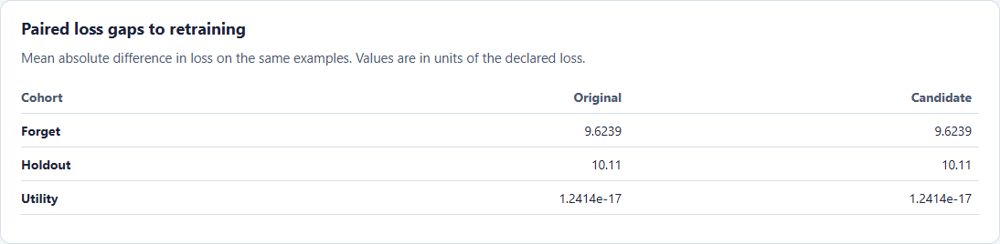

# Exact ridge removal and an unchanged control

Run this experiment after installing the package and the demo dependencies.

```sh
python examples/ridge_control.py ridge-demo
unlearning-audit verify ridge-demo/exact/metrics.json ridge-demo/exact/losses.csv --manifest ridge-demo/exact/manifest.json
```

The script creates an audit for each candidate and writes `controls.json` with the coefficient and prediction comparisons. Open either `report.html` to see the ROC curve and paired loss gaps.

## Experimental design

Each synthetic row has one active feature. The retained rows and utility holdout use the first feature. The forget rows and independent audit holdout use the second. Their positive feature values are sampled from the same continuous distribution. The original ridge model is fitted on the two training cohorts with no intercept and a fixed positive penalty. The exact candidate subtracts the forget rows' contributions from the original Gram matrix and feature-target cross product. The unchanged candidate uses the original coefficients. The reference is fitted from scratch on retain rows with scikit-learn's SVD solver.

The normal equations are `(XᵀX + αI)w = Xᵀy`. Subtraction leaves the sufficient statistics of the retained rows in exact arithmetic. The positive penalty makes the solution unique. The experiment checks equivalence up to floating-point error under this objective and fixed feature encoding. Data-dependent preprocessing would have to be recomputed separately. [Ridge objective](https://scikit-learn.org/stable/modules/linear_model.html#ridge-regression-and-classification)

## Observed results

The default run uses seed 42, with 100 forget rows and 200 holdout rows.

| Candidate | ROC AUC | Largest holdout prediction gap to retraining | Mean absolute paired holdout loss gap |
| --- | ---: | ---: | ---: |
| Exact update | 0.52665 | 0 | 0 |
| Unchanged | 0.52665 | 4.33431 | 10.11010 |

Both candidates rank second-feature examples in the same order. Each model's squared errors in that direction are a positive constant times the squared feature values. ROC AUC therefore stays the same even though the magnitude of the errors changes. The experiment isolates a limitation of ranking metrics. It is a deliberately constructed control, with two features and no label noise.



Use `compare --loss-gaps` to include the same metric in a regular audit. A nonzero gap shows disagreement with the reference on the observed losses. Even a zero gap does not establish equality of predictions, parameters, or behavior outside the supplied examples.
