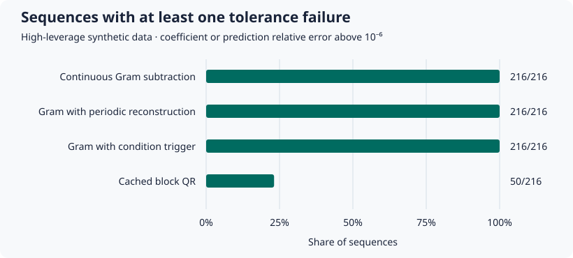

# Sequential ridge removal experiment

The experimental block QR implementation retains a local copy of the training rows and caches a factor for each block. A deletion recomputes factors for touched blocks and solves using the combined factors and one ridge regularization term. The example is intended for numerical comparison. Input arrays and factors remain in memory and are included separately in its byte counts.

The [v0.5.0 results archive](https://github.com/keynepekar/unlearning-audit-toolkit/releases/download/v0.5.0/research-results-v05.zip) contains the recorded policy traces and calibration, the block-size comparison, and both Wine experiments. The commands below regenerate the separate synthetic sequential benchmark and the prediction controls.

## Run the synthetic experiment

```sh
python -m pip install . -r examples/requirements-demo.txt
python examples/sequential_benchmark.py sequential-results
python examples/summarize_sequences.py sequential-results/sequences.csv sequential-results/summary.csv
```

The script writes a configuration with its SHA-256 and one CSV row per method and deletion step. The full profile crosses six seeds, 10 or 100 steps, three regularization strengths, three feature spectrum ratios and two leverage settings. Every sequence removes the first 100 rows and compares each step against a scikit-learn SVD refit on remaining rows. Requests arrive in fixed contiguous order. Timings include the update or refit for that step and exclude initial factorization and data generation. Use `--quick` for the CI profile.

On the recorded Windows run, 132 of 216 Gram-subtraction sequences and 26 of 216 QR sequences had at least one step where coefficient or holdout prediction relative L2 error exceeded 10⁻⁶. The largest holdout prediction errors were 5.98 for Gram and 7.72 × 10⁻⁷ for QR. These cases include deliberately ill-conditioned inputs. They are comparisons for the stated configuration and do not establish a numerical guarantee.

## Public-data example

Download the red wine CSV from [UCI Wine Quality](https://archive.ics.uci.edu/dataset/186/wine+quality), then run:

```sh
python examples/wine_experiment.py winequality-red.csv wine-results
```

The script verifies the expected SHA-256, removes duplicate full rows before splitting, uses the original quality score, and adds a penalized intercept. It reports separate results for four train/test splits, two removal fractions, and random or nearest-neighbor selection. Distances use standard deviations from the full training split for selection only. The model uses fixed raw features. The UCI dataset is by Cortez et al. (2009), licensed CC BY 4.0, DOI [10.24432/C56S3T](https://doi.org/10.24432/C56S3T). [License](https://creativecommons.org/licenses/by/4.0/)

`python examples/wine_neighbors.py winequality-red.csv neighbors.csv` compares a refit after deleting one anchor row with a refit after deleting that anchor and nine nearest training rows. Across ten split seeds, the mean absolute difference between the two refitted anchor predictions was 0.00415 and the maximum was 0.0100. This is an example of how the choice of deletion set affects a model under one ridge objective, rather than a test of deletion guarantees.

For the initial random-selection run, the largest relative holdout prediction errors versus the SVD refit were 3.35 × 10⁻¹⁴ for Gram and 4.93 × 10⁻¹⁵ for block QR. Splits may share observations across runs. Deduplicating full rows permits identical features with different targets to occur in different splits.

## Scope

The CSV includes per-step timings and memory for stored inputs and factors. It does not measure peak process memory. The equal-squared-loss regression control in the test suite demonstrates that identical losses can mask different predictions.

## Reconstruction policy experiment

```sh
python examples/reconstruction_policies.py policies
python examples/prediction_controls.py
```

The policy experiment adds concentrated and dispersed removal patterns and compares continuous subtraction, reconstruction every ten requests, reconstruction when the updated Gram matrix condition number exceeds 10¹⁰, and cached block QR. It records each request and a summary with total, median and 95th percentile update times. Initial setup is excluded. The fixed threshold is exploratory and has not been calibrated on held-out sequences. QR block factors retain access to the original rows.

In the recorded full run, each method has 216 sequences. All 216 sequences in each Gram policy exceeded the coefficient or prediction tolerance at least once. Block QR exceeded it in 50 sequences. The condition rule rebuilt 11,551 times across its sequences. These deliberately high-leverage cases demonstrate a limitation of that threshold and of the normal-equation solve. They are not a general estimate of production reliability.

`python examples/calibrate_condition.py policies/steps.csv calibration.json` evaluates six condition thresholds retrospectively using seeds 42–44 to choose a threshold and 45–47 to evaluate it. It chooses 10⁴ by minimizing missed failures and then false alerts. The held-out steps contain 5,940 failures, of which 30 are missed, and no non-failure steps. Thus this dataset cannot estimate a false-alert rate. The rows were generated under the fixed 10¹⁰ reconstruction policy, so this exercise does not measure how a different threshold would alter subsequent model states.



Generate the chart from the output:

```sh
python examples/plot_policy_results.py policies/summary.csv policies/results.svg
```

The prediction controls construct equal squared losses with predictions on opposite sides of the target. Their AUC and paired loss gap are identical, while the mean prediction gap is one unit. A one-row change also shows how a 95th percentile can miss a rare deviation. These examples motivate inspecting both per-group and worst-case behavior.

## Block size and locality

```sh
python examples/block_costs.py block-results
```

The 324 scenarios compare three block sizes and two locations for a single removal of 100 rows. In the recorded run, median touched-block counts were 4, 2 and 1 for concentrated removal with block sizes 32, 64 and 128. The corresponding dispersed counts were 30, 16 and 8. The CSV reports setup and update times separately from an SVD refit, plus coefficient and prediction errors. Each time is a single observation, so the timings are exploratory and do not include measurement uncertainty.

## Held-out policy replay and order comparison

```sh
python examples/validate_reconstruction.py reconstruction-heldout.json
```

The replay uses both ordinary and high-leverage data, three spectrum ratios, two penalties and 10 or 100 requests. Calibration uses seeds 42–44 and maximizes balanced accuracy over six thresholds on uninterrupted Gram traces. Seeds 45–52 evaluate the chosen threshold by actually rebuilding the statistics when it fires. An alert is evaluated against the error of the Gram solve immediately before the rebuild. The same SVD reference also measures the error after that decision.

The chosen threshold was 10¹⁰. In 31,680 held-out steps, 17,782 alerts coincided with a pre-rebuild failure, 36 were false alerts, 564 failures were missed, and 13,298 steps had neither an alert nor a failure. After the policy ran, 18,329 steps still exceeded the tolerance. The condition number detects many problematic solves in this grid. Rebuilding Gram statistics still leaves the numerical limits of the normal equations.

The 576 held-out sequences include forward, reverse and shuffled requests that remove the same 100 rows. Final block QR matched single-request block QR exactly on this machine. The largest final relative prediction error against an independent SVD refit was 2.67 × 10⁻¹². The JSON also records the final errors for single-request Gram and the sequential Gram policy.

## Repeated costs and process memory

```sh
python examples/repeated_costs.py repeated-costs.json
```

The full profile runs 36 isolated workers, with one warm-up and 11 measured repetitions per worker. It records setup and update times separately. The memory figure is the process high-water mark, including imports and inputs. Windows reports peak working set and Linux reports peak resident memory. Compare measurements within the same operating system and environment.

For 24,000 rows, 64 features and 10% deletion, the median update time on the recorded Windows run was 9.70 ms for concentrated QR removal and 29.03 ms for dispersed QR removal. Corresponding SVD refits took 81.52 ms and 77.49 ms. QR setup took about 22 ms in each case. Peak process memory was 153–158 MiB for QR and about 185–186 MiB for SVD. These results describe one CPU environment.

## Cluster bootstrap coverage

```sh
python examples/bootstrap_coverage.py bootstrap-coverage.json
```

The simulation uses paired differences with known mean 0.2, equal groups of eight rows, and 600 datasets per scenario. It compares percentile intervals from 799 draws that resample individual rows or whole groups. Across the correlated scenarios, coverage was 53–72% for row sampling and 89–94% for group sampling at nominal 95%. Results apply to this simulation and the mean paired difference. They do not measure coverage for AUC or establish validity for arbitrary group structures. [Field and Welsh, Bootstrapping clustered data](https://doi.org/10.1111/j.1467-9868.2007.00593.x)

## Wheel verification

The Wheel provenance workflow builds and smoke tests the wheel, attests its SHA-256 digest, verifies the attestation and uploads the wheel as a workflow artifact. Download the wheel from the run and execute `gh attestation verify path/to/wheel.whl --repo keynepekar/unlearning-audit-toolkit`. [Verified workflow run](https://github.com/keynepekar/unlearning-audit-toolkit/actions/runs/43375466641) · [GitHub CLI verification](https://cli.github.com/manual/gh_attestation_verify)
